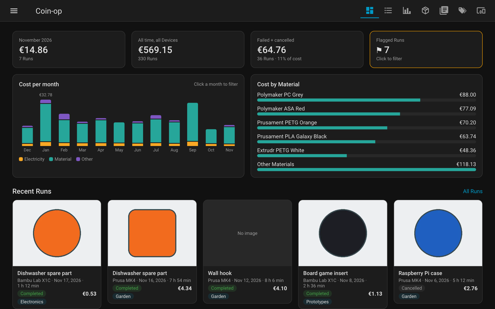
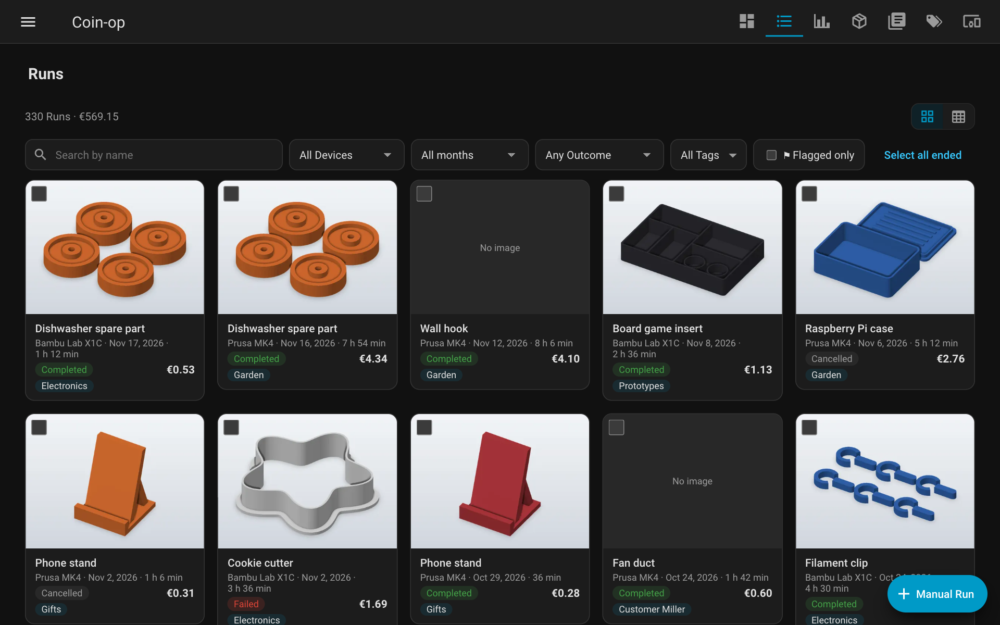
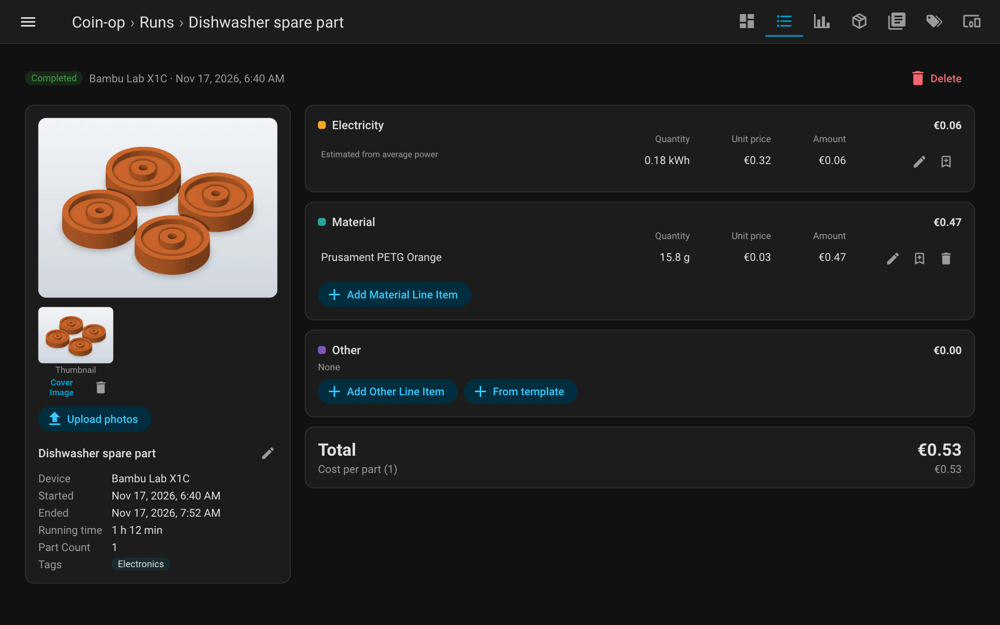
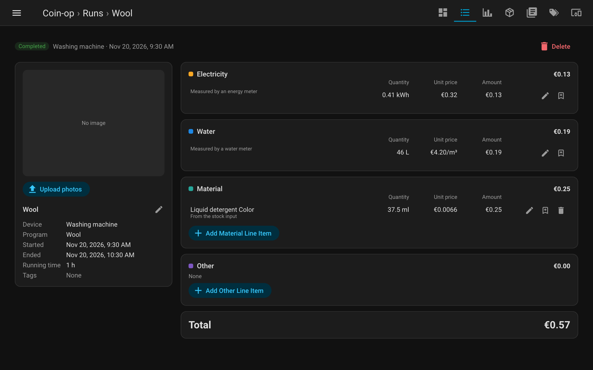
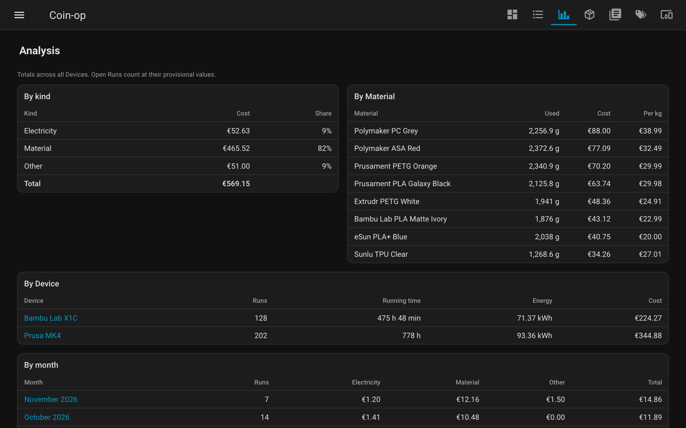
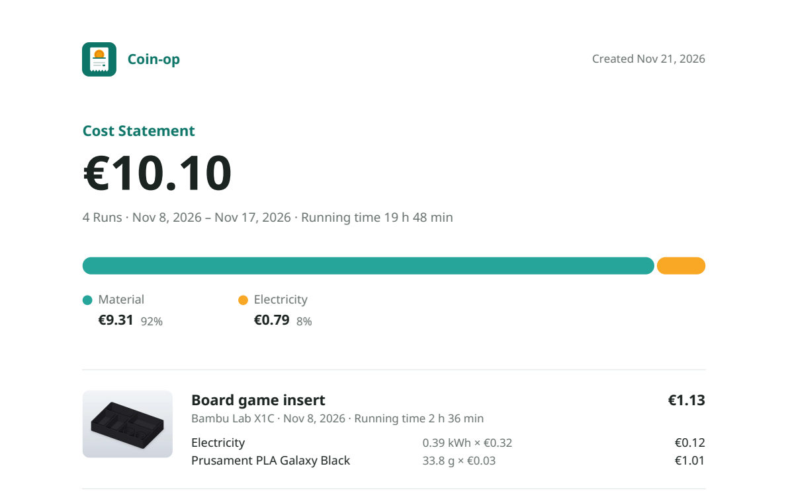
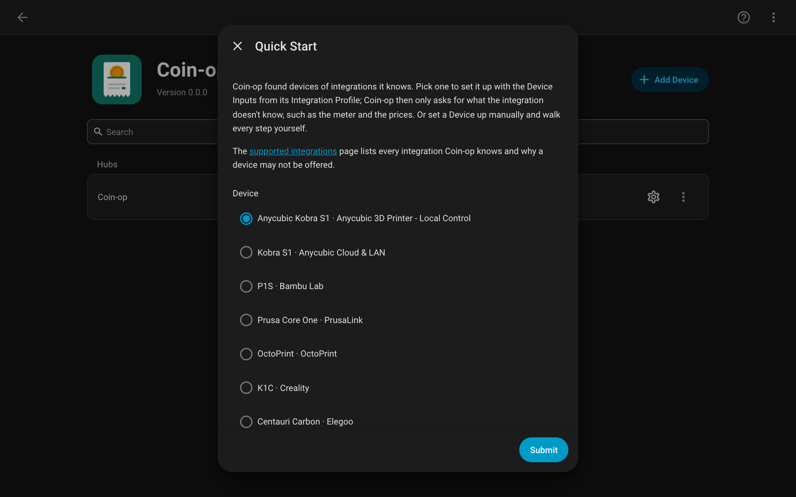

  

  
  
  
  
  

A Home Assistant custom integration that records what each Run of your household devices costs, such as each print of a 3D printer or each program of a washing machine or dishwasher: electricity, water, material, detergent and anything else you add, kept as an editable history of Runs.

  

Requires Home Assistant 2026.5 or newer. Licensed under the [MIT licence](LICENSE).

Contributing: see [CONTRIBUTING.md](CONTRIBUTING.md).

## Features

- **Runs from the Device's status**: every print, wash, charge or mowing session opens and closes on its own, with a live cost while it runs.
- **Costs as Line Items**: electricity, water, material, detergent and other Doses, plus anything you add by hand or from templates.
- **Electricity from any source**: an energy meter, a power sensor or an estimate from average power, priced correctly across every price change.
- **Many Device Types**: 3D printers, washing machines, dishwashers, tumble dryers, coffee machines, ovens, EV chargers, robotic mowers, and **Other** for anything else. See [Device Types](#device-types).
- **Quick Start**: devices of [supported integrations](docs/supported-integrations.md) are set up in a few clicks. Coin-op only reads their entities, so a device of any integration that exposes a status works.
- **Editable history**: a sidebar panel with a gallery of Runs, Tags, Flags and analysis, where every value can be corrected afterwards.
- **Sensors and events**: cost totals, consumption, Run count, running time, the current and last Run's cost, the open Run's Projected Total, and a Run event entity for automations.
- **Cost Statement**: a PDF of the selected Runs, detailed or compact, optionally with a Markup.
- **Local and backed up**: all data stays in Home Assistant and is part of its backups.

## Screenshots

<table>
  <tr>
    <td width="50%" valign="top">
      
       Every Run as a tile, filtered by Device, month, outcome and Tag
    </td>
    <td width="50%" valign="top">
      
       A Run's Line Items, each correctable afterwards
    </td>
  </tr>
  <tr>
    <td width="50%" valign="top">
      
       A washing machine load: electricity, water and detergent
    </td>
    <td width="50%" valign="top">
      
       Costs by kind, Material, Device and month
    </td>
  </tr>
  <tr>
    <td width="50%" valign="top">
      
       A Cost Statement PDF of the selected Runs
    </td>
    <td width="50%" valign="top">
      
       Quick Start offers the devices of known integrations
    </td>
  </tr>
</table>

## Device Types

The Device Type is chosen when a Device is added and can't be changed afterwards. It decides which setup steps the Device has and what its Runs record. Every Device has a Status that opens and closes its Runs and an electricity source with its price, and every Run takes Line Items you add by hand or from templates. The electricity source of every Device Type can also be [None](docs/electricity.md#electricity-source-none), for a Device whose electricity you don't follow.

| Device Type | A Run records | Pre-filled for |
|---|---|---|
| 3D printer | Electricity (energy meter, power sensor or an estimate from average power), the material used (per Slot with a multi-material unit), Part Count, Thumbnail and Snapshot | [Anycubic 3D Printer - Local Control, Anycubic Cloud & LAN, Bambu Lab, PrusaLink, OctoPrint, Creality, Elegoo, Moonraker](docs/supported-integrations.md#3d-printers) |
| Washing machine | Its Program, electricity and water (measured or per Program) and the Doses of detergent and other products | [WashData, Miele, Home Connect, Home Connect Local, Home Connect Alt, LG ThinQ, SmartThings](docs/supported-integrations.md#washing-machines-and-other-appliances) |
| Dishwasher | Its Program, electricity and water (measured or per Program) and the Doses of tabs, salt and other products | [WashData, Miele, Home Connect, Home Connect Local, Home Connect Alt, LG ThinQ, SmartThings](docs/supported-integrations.md#washing-machines-and-other-appliances) |
| Tumble dryer | Its Program, electricity (measured or per Program) and, if you list any, the Doses of dryer sheets or fragrance | [WashData, Miele, Home Connect, Home Connect Local, Home Connect Alt, LG ThinQ, SmartThings](docs/supported-integrations.md#washing-machines-and-other-appliances) |
| Coffee machine | The drink as its Program, electricity and water (per Program or measured) and the Doses of beans, milk and other ingredients | [WashData, Miele, Home Connect, Home Connect Local, Home Connect Alt](docs/supported-integrations.md#washing-machines-and-other-appliances) |
| Oven | Its Program and electricity (measured or per Program) | [WashData, Miele, Home Connect, Home Connect Local, Home Connect Alt, LG ThinQ, SmartThings](docs/supported-integrations.md#washing-machines-and-other-appliances) |
| EV charger | The electricity of a charging Run, from a session or lifetime energy sensor or a power sensor. See [EV chargers](docs/ev-chargers.md) | [Tesla Wall Connector, evcc, OCPP, Easee, Zaptec, go-e Charger MQTT, go-e Charger API v2, Wallbox](docs/supported-integrations.md#ev-chargers) |
| Robotic mower | The electricity of a mowing Run, the recharge after it included. See [Robotic mowers](docs/robotic-mowers.md) | no integration: set up manually |
| Other | Its electricity and whatever you pick for it: a Program, Doses, water, a job with its Material, images, a Part Count. See [Other Devices](docs/other-devices.md) | no integration: set up manually |

**Other** is for a Device none of the shipped Device Types fits. You give it a Type Name and pick what it has yourself, and unlike the Device Type, both can be changed later.

"Pre-filled for" names the integrations Coin-op has an Integration Profile for: their devices are offered by [Quick Start](docs/adding-a-device.md#quick-start), which adds each as the Device Type its integration says it is, and manual setup comes pre-filled for them whenever you pick a Device Type the integration is named for. What each profile fills in, and its notes, are under [Supported integrations](docs/supported-integrations.md). A device of any other integration is set up manually, by picking its entities yourself.

Washing machines and the other appliances, EV chargers, robotic mowers and Other Devices each have a page of their own, listed under [Documentation](#documentation).

## Installation

Coin-op is installed through HACS (Home Assistant 2026.10 and older) or the built-in Marketplace (Home Assistant 2026.11 and newer). Until it is in the default catalog, add it as a custom repository:

1. Select the badge above, or add `https://github.com/SpiderDan98/coinop-ha-integration` as a custom repository of type **Integration**. On the Marketplace this needs a GitHub connection.
2. Download Coin-op. With HACS, restart Home Assistant afterwards; the Marketplace needs no restart for a first install. Updates always need a restart.
3. Go to **Settings > Devices & services > Add integration**, pick **Coin-op** and add your first Device.

## Quick Start

Add Device always starts with **Quick Start**. It lists the devices of the integrations Coin-op has an Integration Profile for, takes over their Device Type, name and entities, and only asks for what no profile knows: the energy meter or power sensor and the prices. Choose **Set up manually** to walk every step yourself, for a device of any other integration or to map different entities.

[Adding a Device](docs/adding-a-device.md) explains both ways and how to go back in the dialog.

## Documentation

- [Adding a Device](docs/adding-a-device.md): Quick Start, manual setup and going back
- [Supported integrations](docs/supported-integrations.md): what each Integration Profile fills in, and why a device may not be offered
- [Electricity](docs/electricity.md): estimating without a meter, and the electricity source "None"
- [Washing machines and other appliances](docs/appliances.md), [EV chargers](docs/ev-chargers.md), [Robotic mowers](docs/robotic-mowers.md), [Other Devices](docs/other-devices.md)
- [Spoolman](docs/spoolman.md): Filaments from Spoolman as Materials
- [Dashboards](docs/dashboards.md): monthly costs with statistic cards

## Cost Statement

Select ended Runs in the panel and download a Cost Statement: a PDF in English or German, detailed (every Line Item and the Cover Image per Run) or compact (one row per Run), optionally with a Markup on top. It opens with the total and how it splits into electricity, water, material and other costs. It is explicitly not an invoice. A default Markup can be set in the integration options. With exactly one Tag filtered, the title defaults to "Cost Statement – <Tag>". The browser remembers the last export options except title and note. The download works the way Home Assistant's own backup download does, so it also works from the Companion app.

## Currency

Cost sensors use the currency configured in Home Assistant. If you change that currency later, amounts are not converted: old and new amounts continue in the same sensors, and Home Assistant raises its own repair issue about the changed statistics unit.

## Your data

Coin-op keeps everything inside Home Assistant: its data files in `.storage/coinop.*` and its images in the `coinop` folder of the configuration directory. Both are part of Home Assistant backups, and restoring a backup brings all of Coin-op back to that moment. Sensor totals are rebuilt from the stored Runs at every start.

If the recorder database and Coin-op's data are restored from different points in time, the total sensors jump once in long-term statistics. Coin-op does not correct this.

If a data file can't be read (for example a corrupt file after a crash), Coin-op does not start, so it can't overwrite your history; a repair issue lets you restore a backup or deliberately start fresh.

Removing the Coin-op integration deletes all of its data: every data file, the `.bak` copies kept from before upgrades, and the `coinop` folder. Make a backup first if you may want it back.
